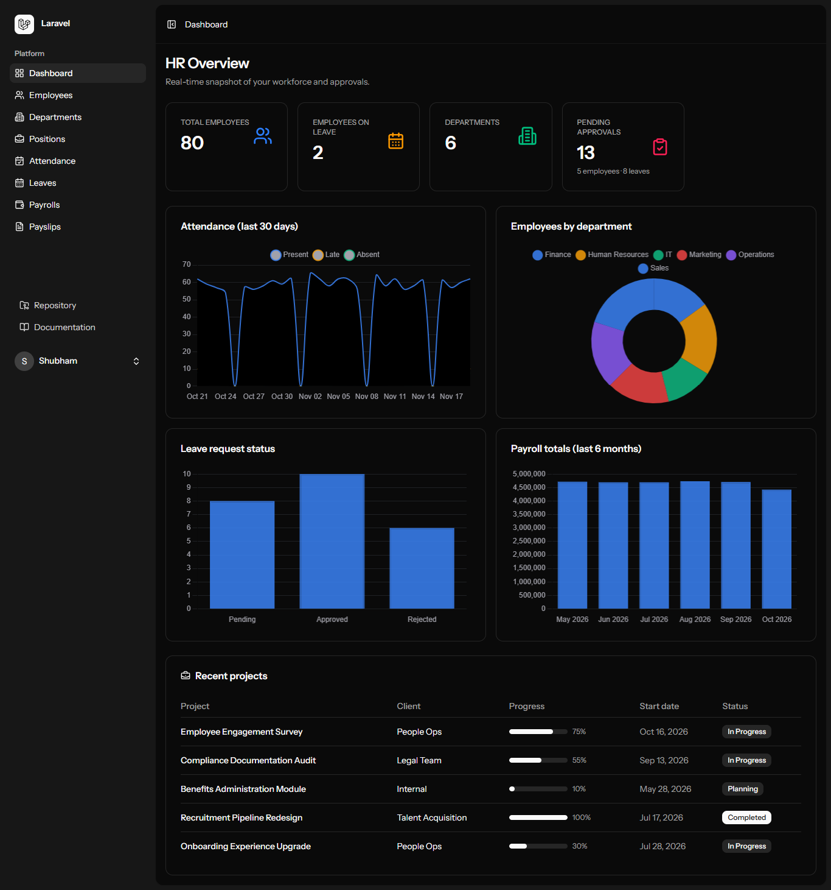
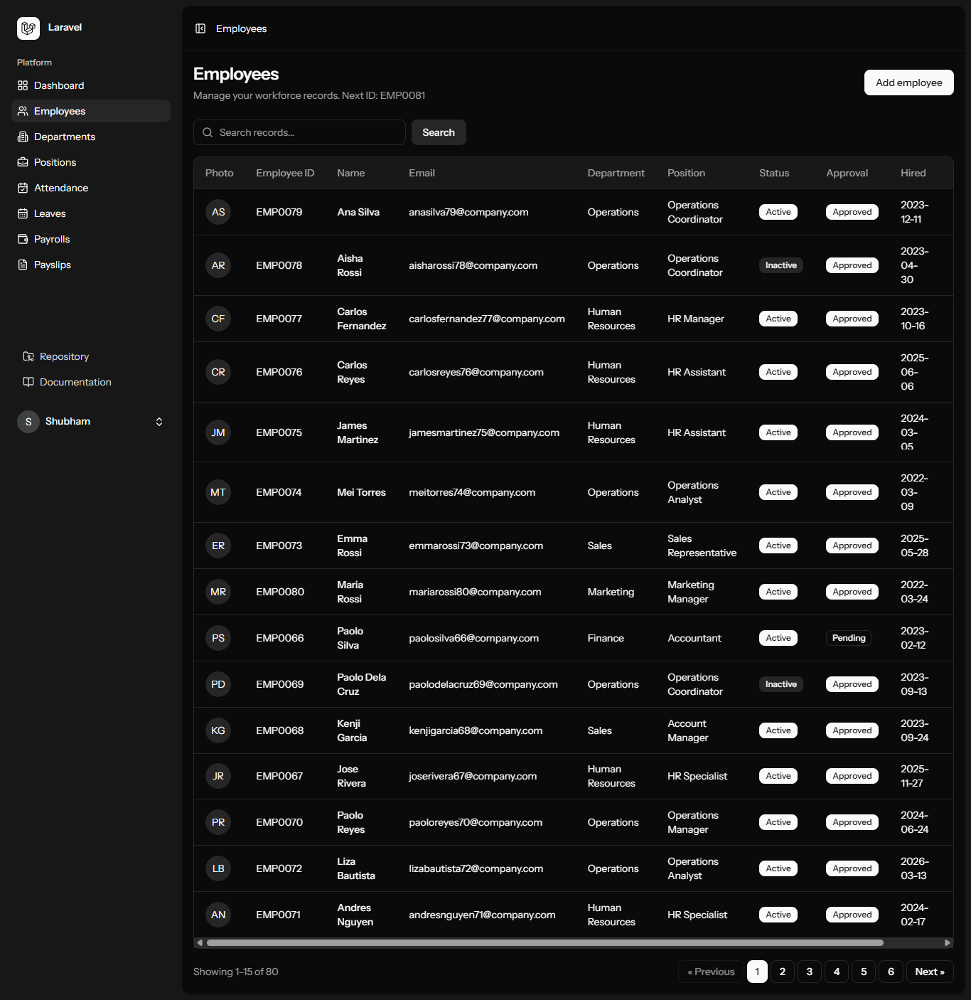
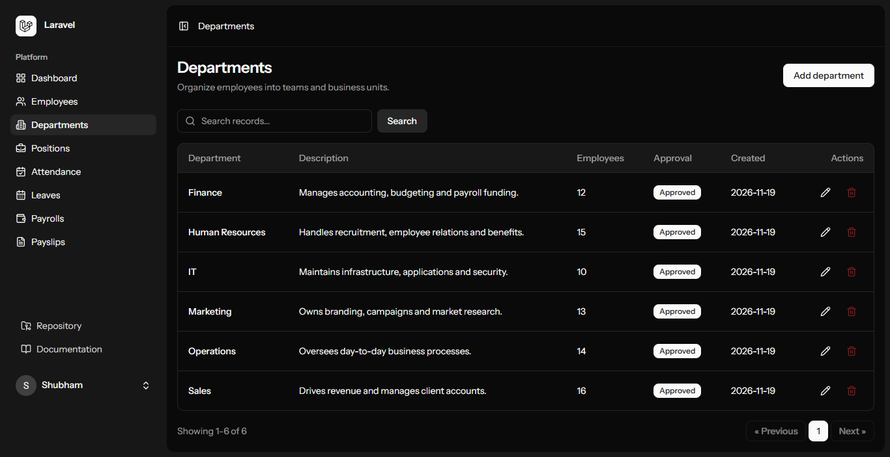
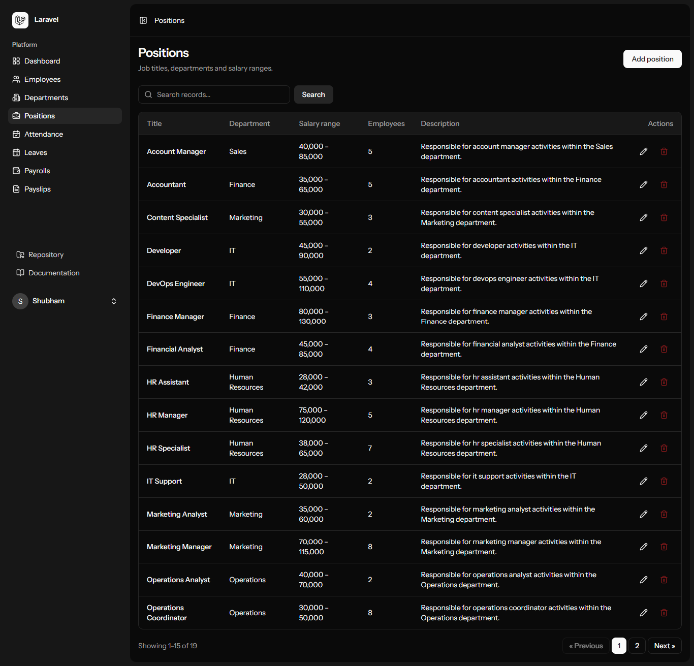
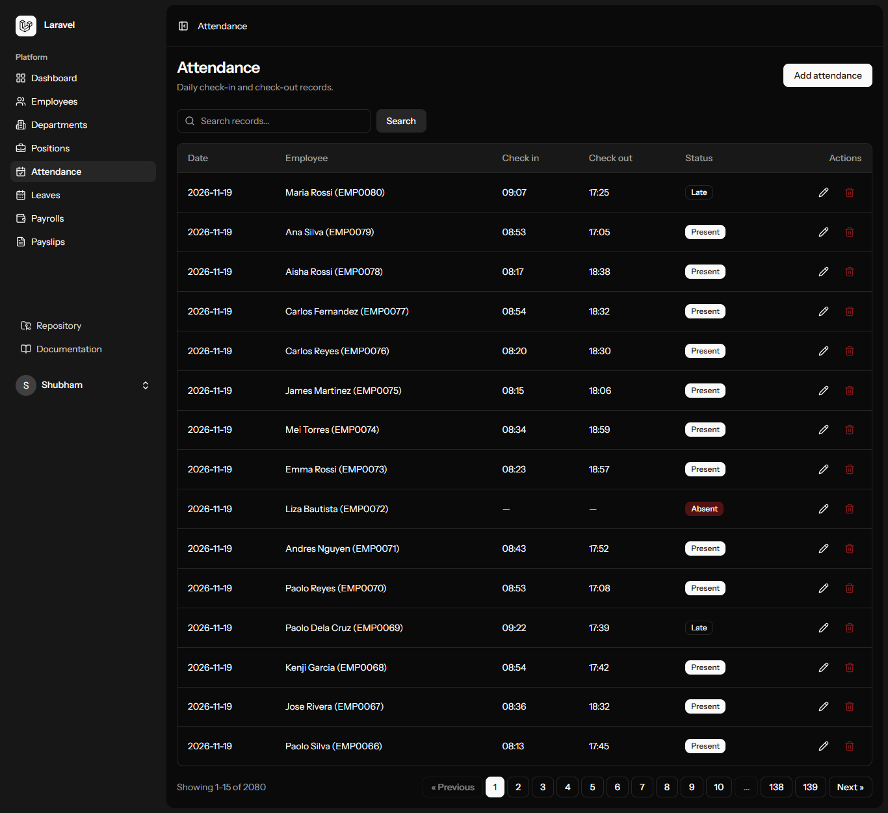
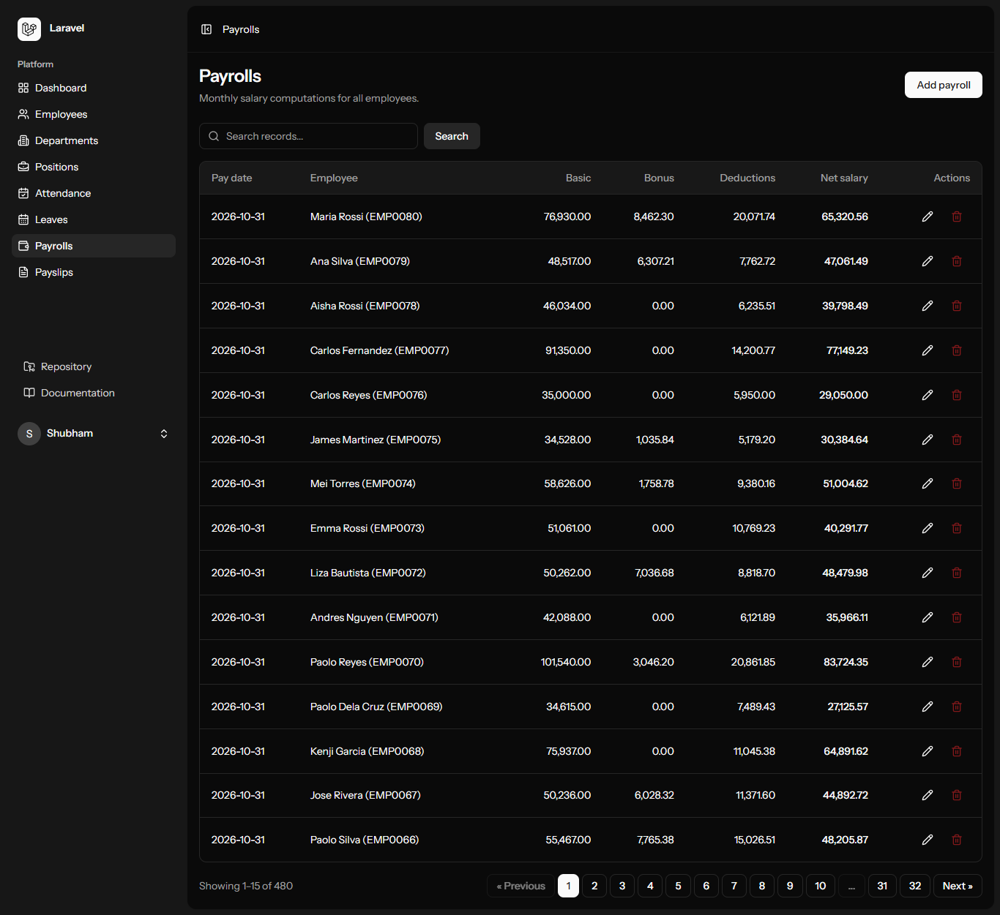
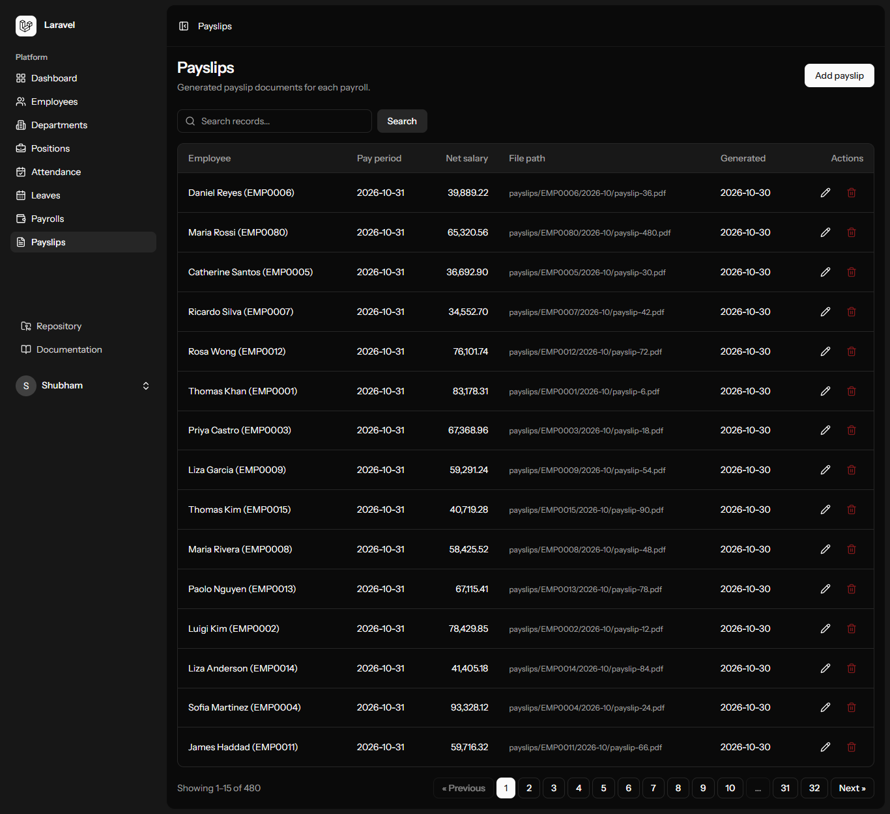

# Human Resource Management System

A Laravel and React-based HR management system for organizing and monitoring employee operations in one place. It includes employee, department, position, attendance, leave, payroll, and payslip management, along with a real-time dashboard showing workforce and approval statistics.

## Screenshots

